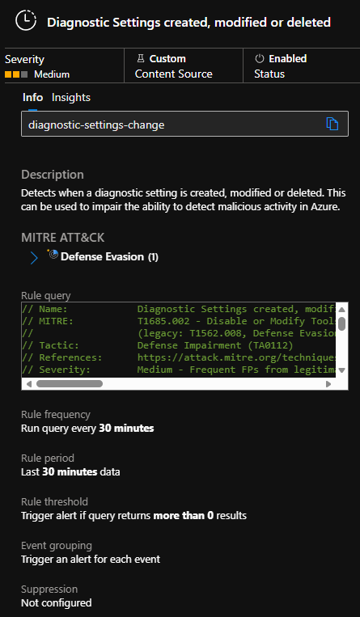
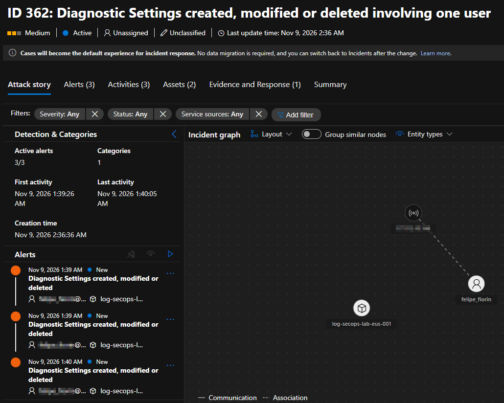
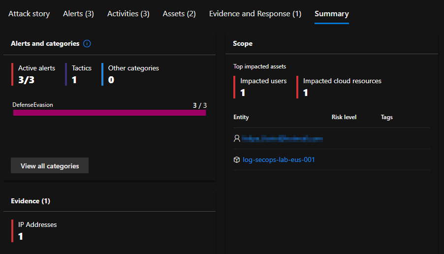

# Sentinel Detection as Code (DaC) - Lab

Microsoft Sentinel and its detection rules deployed with Terraform: KQL detections mapped to MITRE ATT&CK.

## Problem

- Why are manually created/edited detection rules a problem?  
Everything is done manually (GUI-based). The team has to perform manual tests and adjustments if needed. There is no version control, or just a basic history.
Scalability is difficult and depends on the tool.

- Why this detection matters  
If an attacker can turn off or redirect logs, every other detection goes blind. This rule watches for changes to the settings that send Azure logs to Sentinel.

## What I built
- Infrastructure resources naming convention follows the [Cloud Adoption Framework](https://learn.microsoft.com/en-us/azure/cloud-adoption-framework/ready/azure-best-practices/resource-naming).  
Terraform creates the resources below:
    - Budget alert
    - Resource Group
    - Log Analytics Workspace
    - Sentinel onboarding
    - Diagnostic Settings at subscription level (Administrative, Security, Policy)
    - Analytics Rule mapping entities and MITRE
- Security decisions:  
    - Workspace has no shared keys
    - Secrets out of repo
    - Budget alert to avoid surprise costs
- The detection:
    - It detects any Diagnostic settings create, edit, or delete operation for any resource in the subscription.
    - [Disable or Modify Tools: Disable or Modify Cloud Log](https://attack.mitre.org/techniques/T1685/002/)
        - ID: T1685.002
        - Sub-technique of: T1685
        - Tactic: Defense Impairment

## Architecture
- Activity Log -> Diagnostic Setting -> Log Analytics -> Sentinel rule -> Incident (Defender XDR)

## Detections
| Rule | MITRE ATT&CK | Tactic | Severity | File |
|------|--------------|--------|----------|------|
| Diagnostic Settings created, modified or deleted | T1685.002 (legacy T1562.008) | Defense Impairment | Medium | [Rule](/rules/defense-impairment/T1685.002-diagnostic-settings-modified-or-deleted.kql) |

## Results
I manually created a diagnostic setting, edited it, and deleted it. These operations generated 3 alerts (create/modify/delete) and 1 incident.
- Analytics Rule  
  
- Incident Attack Story  
  
- Incident Summary / Entities  
  
- Activity logs can take [3 to 20 minutes to be ingested](https://learn.microsoft.com/en-us/azure/azure-monitor/logs/data-ingestion-time#azure-metrics-resource-logs-activity-logs), so this rule is not real-time (see Roadmap: NRT rule).  

## Lessons learned
- Activity Log events come in pairs. My first version raised two alerts per change, because Azure logs a `Start` event and a `Success/Failure` event for each operation. I filtered out `Start` but kept failures, since a failed attempt can be an attacker without enough permissions.  
Lesson: Understand how the data source logs events before writing the detection.
- The rule depends on the log it protects. If the subscripion-level diagnostic settings is deleted, logs stop being ingested, which may stop alerts and incidents.  
Lesson: Every detection has its own limitations. You must document everything.
- If anything is edited in the Diagnostic Settings, it only shows in the `Start` event. Neither the `Success` nor the `Failure` event shows what changed.  
Lesson: Sometimes the context lies in a different event. A correlation must be created to show everything the responder needs.
- MITRE changed in 2026. T1562.008 is now T1685.002, under a new tactic (Defense Impairment), and Sentinel doesn’t support it yet. That's why both are mentioned in the README and in the .kql file.  
Lesson: Frameworks evolve faster than tools.

## Repository structure
- `providers.tf` – Terraform and azurerm provider versions
- `variables.tf` – Input variables (naming, location, budget emails)
- `locals.tf` – Naming suffix and common tags
- `main.tf` – Resource Group, Log Analytics Workspace, Sentinel onboarding
- `diagnostics.tf` – Subscription Activity Log to Log Analytics Workspace
- `budget.tf` – Subscription budget alerts
- `rules.tf` – Sentinel analytics rules (load queries from `rules/`)
- `.terraform.lock.hcl` – Provider version lock
- `rules/` – KQL detections, grouped by MITRE ATT&CK tactic
    - `defense-impairment/`
- `images/` – Screenshots

## How to deploy
- Prerequisites:
    - Azure subscription
    - Azure CLI
    - Terraform

- First you need to log in to Azure CLI.  
You can use: `az login`
- Set the environment variable `ARM_SUBSCRIPTION_ID`:
    - PowerShell: `$env:ARM_SUBSCRIPTION_ID = "<subscription-id>"`
    - Bash: `export ARM_SUBSCRIPTION_ID="<subscription-id>"`
- Create file `terraform.tfvars`
    - Variable to add: `budget_alert_emails = ["email.address@provider.com"]`
- Commands:
    - `terraform init`
    - `terraform plan`
    - `terraform apply`
        

## Roadmap
- [ ] CI/CD with GitHub Actions + OIDC
- [ ] Playbook to automatically respond (Logic App)
- [ ] NRT rule to reduce detection time
- [ ] Enrich the alert with the request body (join via CorrelationId)

## Disclaimer
Lab project in a personal Azure subscription. Not production.